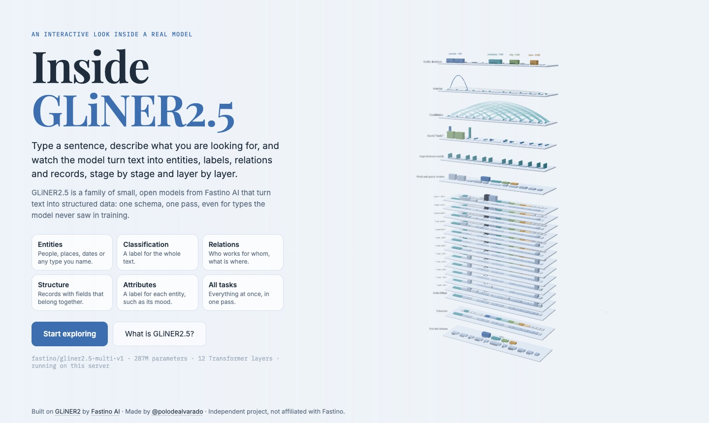
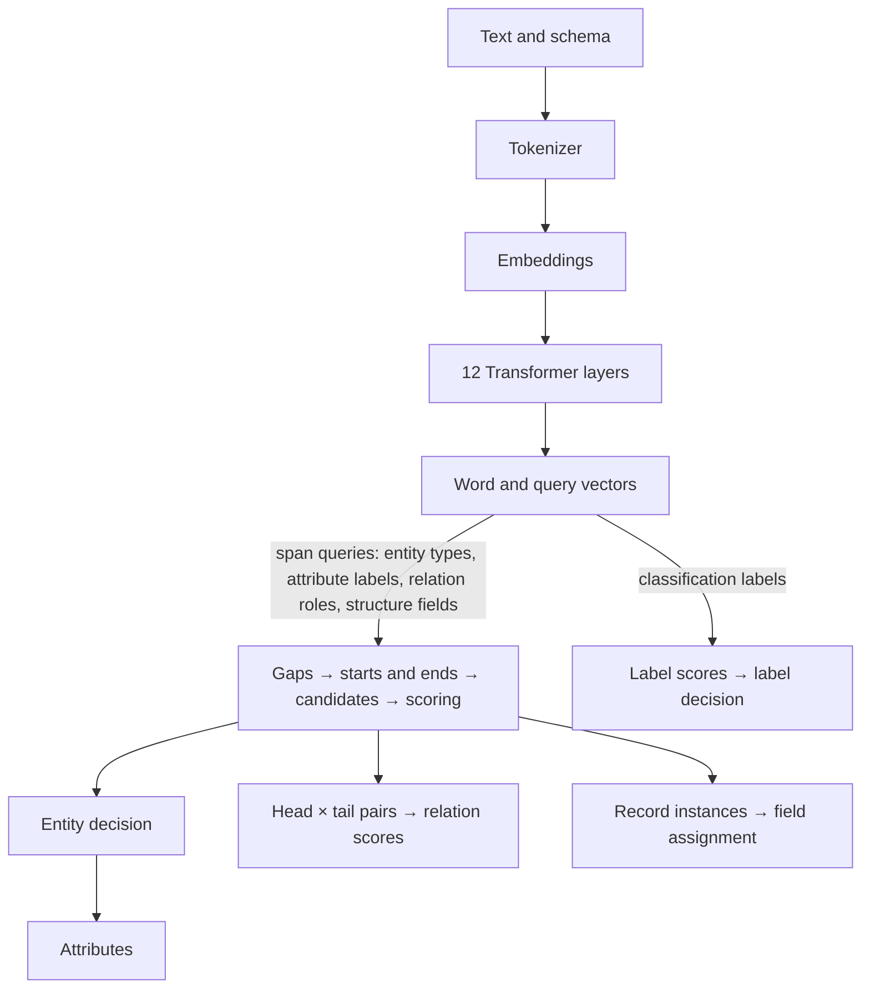
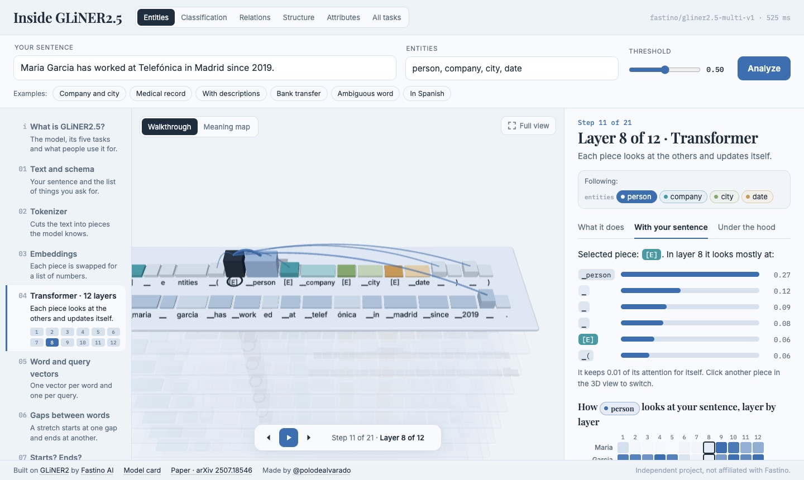
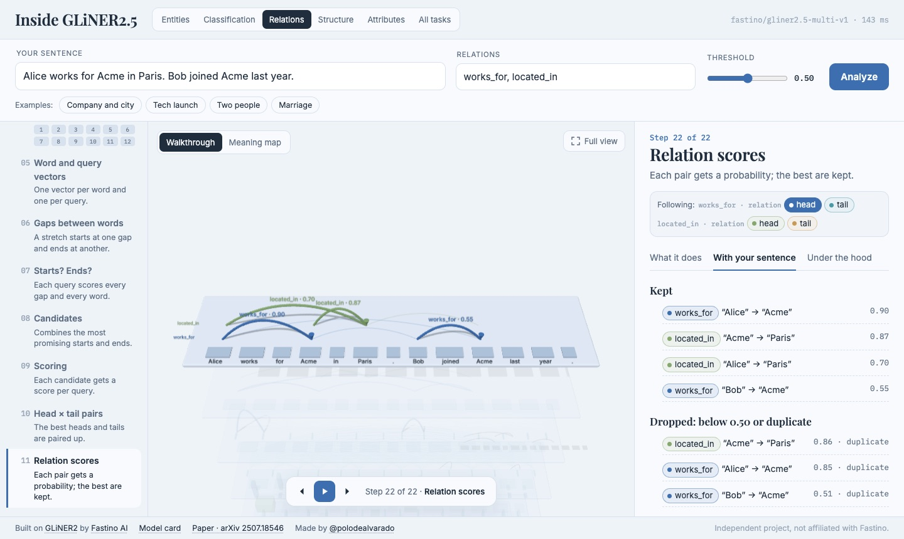
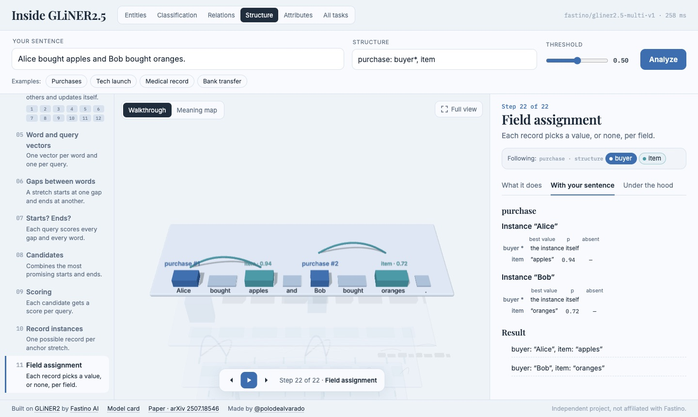
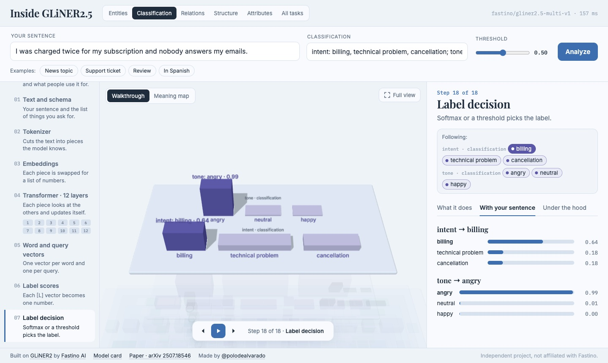
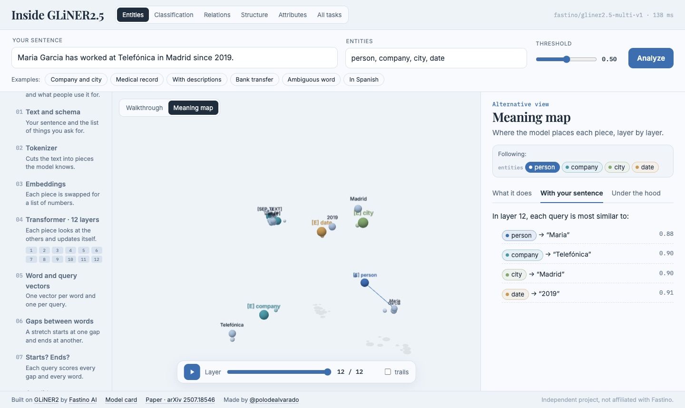

<div align="center">

# Inside GLiNER2.5

**Watch a real information-extraction model read your sentence, stage by stage and layer by layer.**

[](https://huggingface.co/spaces/polodealvarado/gliner2-visualizer)
[](https://huggingface.co/fastino/gliner2.5-multi-v1)
[](https://github.com/fastino-ai/GLiNER2)

<a href="https://huggingface.co/spaces/polodealvarado/gliner2-visualizer"></a>

</div>

Inside GLiNER2.5 is an interactive 3D walkthrough of [GLiNER2.5](https://huggingface.co/fastino/gliner2.5-multi-v1), the open information-extraction model from [Fastino AI](https://fastino.ai).
You write a sentence and a schema: the entity types, labels, relations and fields you want.
The real model answers, and the page draws what every stage produced: the pieces of your text, the attention inside the 12 Transformer layers, the candidate stretches, their scores and the final answers.
The bars, arcs and numbers on screen come from the model's own intermediate tensors.

It is written for curious readers, students and NLP engineers.
Each stage explains itself three times: in plain words, with the real values for your sentence, and with the shapes and source files of the code.

## Try it

| Where | What you get |
|---|---|
| **[Online](https://huggingface.co/spaces/polodealvarado/gliner2-visualizer)** | Every example of every task, run through the real model ahead of time. No installation. |
| **[On your computer](#run-it-locally)** | `uv run server.py`: any sentence and any schema, live. |

## What is GLiNER2.5?

GLiNER2.5 is a family of small, open models (74M to 287M parameters) that turn text into structured data.
You describe what you want in a schema, and the model answers all of it **in one pass** of its encoder, even for types it never saw during training.
It runs locally on CPU or GPU and returns the exact character offsets of every stretch it extracts.

| Task | What it finds | Example |
|---|---|---|
| **Entities** | Stretches of text of any type you name | “Tim Cook” → person |
| **Classification** | One or several labels for the whole text | topic → technology |
| **Relations** | Typed, directed links between two stretches | Tim Cook → works_for → Apple |
| **Structures** | Records whose fields belong together | purchase: buyer “Alice”, item “apples” |
| **Attributes** | A label from a group for each entity | Tim Cook → mood: happy |

Typical uses: pulling data out of contracts, invoices or medical records; finding personal data before documents are shared; routing support tickets; building knowledge graphs; filling databases from emails or forms.

## A tour of the tower

The page draws the model as a tower of plates, one plate per stage, from your text at the bottom to the answers at the top.
Every task shares the bottom of the tower; only the head on top changes.



| Stage | What it shows |
|---|---|
| Text and schema | The prompt the model really reads: one segment per task, then your text. |
| Tokenizer | The pieces (tokens) of the multilingual mDeBERTa-v3 vocabulary. |
| Embeddings | The 768 numbers each piece starts with, before any context. |
| 12 Transformer layers | What each piece looks at (attention), and how each query focuses on your words. |
| Word and query vectors | One vector per word, one per span query (`[E]`, `[C]`, `[R]`) and one per classification label (`[L]`). |
| Gaps, starts and ends | A stretch starts at one gap between words and ends at another; each query scores every gap. |
| Candidates and scoring | One bag of candidate stretches shared by all queries, and each candidate's probability per query. |
| Heads | Entity decision, attributes, head × tail pairs and relation scores, record instances and field assignment, label scores and label decision. |

Each stage has three tabs: **What it does** (plain words), **With your sentence** (the real values) and **Under the hood** (shapes, parameters and the source file).
The **Meaning map** projects every piece into 3D, layer by layer, so you can watch each query move towards its words.

<table>
<tr>
<td width="50%"></td>
<td width="50%"></td>
</tr>
<tr>
<td align="center"><sub>Layer 8: what the “person” marker looks at</sub></td>
<td align="center"><sub>Relation scores: each arrow goes from head to tail</sub></td>
</tr>
<tr>
<td></td>
<td></td>
</tr>
<tr>
<td align="center"><sub>Field assignment: two purchases, each with its own item</sub></td>
<td align="center"><sub>Label decision for two classification tasks</sub></td>
</tr>
<tr>
<td colspan="2"></td>
</tr>
<tr>
<td colspan="2" align="center"><sub>Meaning map, layer 12: each query sits next to the word it found</sub></td>
</tr>
</table>

## How it works

**The model.** `server.py` loads the checkpoint with `gliner2.AutoExtractor` and wraps a few of its modules with PyTorch hooks.
One `model.extract()` call answers the whole schema, and the hooks keep what each stage produced:

| What the page draws | Where it comes from |
|---|---|
| Hidden states and attention of the 12 layers | the mDeBERTa-v3 encoder (`output_hidden_states`, `output_attentions`) |
| Gap vectors | `boundary_head.boundary_encoder` |
| Start, end and inside scores | `boundary_head.boundary_query_head` |
| Candidate pool and its scores | `boundary_head.shared_pool_builder`, `boundary_head.shared_pool_scorer` |
| “Is there any?” scores of the entity types | `boundary_head.null_projection` |
| Classification scores | `classifier` |
| Relation pairs and their scores | `relation_pair_generator`, `relation_scorer` |
| Attribute scores at the decided entities | `boundary_head.score_explicit_spans` |
| Record instances and field assignment | `record_decoder.forward_group` |

The server also returns the expected number of mentions per query (`boundary_head.count_head`); the page does not draw it yet.

**The page.** `index.html` is a single file: Three.js from a CDN and no build step.
It turns the JSON into plates, tiles, arcs and particles, and writes the three panel tabs from the same numbers.

**The online demo.** Hugging Face hosts it as a free static Space, so there is no server.
`bake.py` runs every example through the real page and model, and stores each answer under the SHA-256 of the exact request.
Without a server, the page plays those answers back and the form becomes read-only.

## Run it locally

```bash
git clone https://github.com/polodealvarado/gliner2-visualizer
cd gliner2-visualizer
uv run server.py            # the first run downloads the model (about 1.2 GB)
open http://localhost:8765
```

[`uv`](https://docs.astral.sh/uv/) reads the dependencies from the header of `server.py` (Python 3.12, `gliner2==2.0.0`, PyTorch).

| Option | Use |
|---|---|
| `--model <repo>` | Another GLiNER2.5 *boundary* checkpoint, for example `fastino/gliner2.5-base-v1`. |
| `--host <addr>` | Address to listen on (default `127.0.0.1`; `0.0.0.0` in Docker). |
| `--port <n>` | Port (default 8765). |
| `--check` | Runs an entity-only sentence and an all-tasks sentence, checks the outputs and exits. |

With Docker:

```bash
docker build -t inside-gliner .        # downloads the model and runs --check
docker run -p 7860:7860 inside-gliner   # then open http://localhost:7860
```

## Write your own schema

Each tab shows only the fields of its task. The syntax is plain text:

| Field | Example | Meaning |
|---|---|---|
| Entities | `person = named people, company` | Entity types; an optional description follows `=`. |
| Attributes | `mood: happy, annoyed → person` | A label group scored at each entity it applies to. Separate groups with `;`. |
| Classification | `topic: tech, sports; tone: good, bad` | Labels for the whole text. Separate tasks with `;`. |
| Relations | `works_for, located_in` | Relation types; each one has a head role and a tail role. |
| Structure | `launch: product*, company, place` | Record fields; `*` marks the anchor (default: the first field). |

Limits per sentence: 60 words, 12 span queries in total (entity types + attribute labels + 2 per relation + structure fields), and 3 classification tasks with 2 to 8 labels each.

<details>
<summary><b>API</b>: <code>POST /api/analyze</code></summary>

One request runs one `model.extract()` call with any mix of tasks:

```json
{
  "text": "Tim Cook, the CEO of Apple, happily presented the iPhone 17 in Cupertino.",
  "threshold": 0.5,
  "entities": {"person": "Named people", "company": null, "product": null},
  "attributes": {"mood": {"labels": ["happy", "annoyed"], "applies_to": ["person"]}},
  "classifications": {"topic": ["technology", "sports", "politics"]},
  "relations": ["works_for", "located_in"],
  "structures": {"launch": {"fields": ["product", "company", "place"], "anchor": "product"}}
}
```

`{"text": "...", "labels": ["person", "city"]}` is the entity-only shorthand.
The answer holds every captured stage, plus the raw output of `model.extract()` under `result`.
Responses are gzip-compressed when the client accepts it, and the server runs one analysis at a time.

</details>

## Deploy the online demo

```bash
uv run server.py     # in one terminal
uv run bake.py       # in another: writes static/ (one JSON answer per example)
```

Then upload `index.html` and `static/` to a static Space, with `SPACE.md` as the Space's `README.md`:

```python
from huggingface_hub import HfApi

api, repo = HfApi(), "polodealvarado/gliner2-visualizer"
api.upload_folder(repo_id=repo, repo_type="space", folder_path=".", allow_patterns=["index.html", "static/*.json"])
api.upload_file(path_or_fileobj="SPACE.md", path_in_repo="README.md", repo_id=repo, repo_type="space")
```

A live Space works with the same `Dockerfile`, but Docker Spaces need a Hugging Face PRO account.

## Simplifications

- Attention is the average of the 12 heads.
- The meaning map is a 3D PCA projection, so its distances are approximate. The similarity figures use the real 768 numbers.
- Each task is decoded on its own. GLiNER2's constrained decoders (`Classifier` rules between tasks, `JointIE` typed relation graphs) are not shown.
- Record plates list at most 8 instances per structure and 8 candidates per field.

## Project layout

| File | Role |
|---|---|
| `server.py` | Loads the model, captures every stage with hooks, serves the page and `/api/analyze`. |
| `index.html` | The whole page: 3D scene, panels, form and start page. |
| `bake.py` | Precomputes the examples for the static demo. |
| `Dockerfile` | Live server image with CPU-only PyTorch. |
| `SPACE.md` | The Hugging Face Space card. |
| `docs/` | Screenshots for this README. |

## Credits

GLiNER2 and the GLiNER2.5 checkpoints are by [Fastino AI](https://github.com/fastino-ai/GLiNER2) and released under Apache-2.0.
Paper: Zaratiana et al., *GLiNER2: An Efficient Multi-Task Information Extraction System with Schema-Driven Interface*, [arXiv:2507.18546](https://arxiv.org/abs/2507.18546), 2025.

Made by [@polodealvarado](https://huggingface.co/polodealvarado). This is an independent project and is not affiliated with Fastino.
